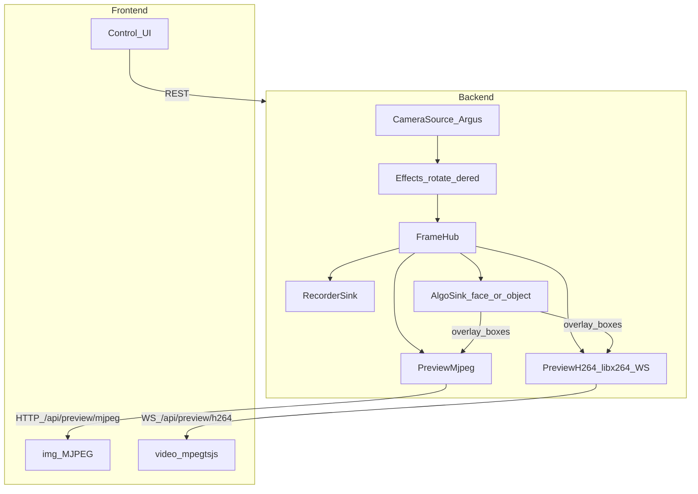

# v2l4_learn 架构设计

> 版本：v1.1  
> 日期：2026-11-09  
> 状态：已落地，持续迭代  

相关文档：

- 使用说明：[../README.md](../README.md)
- **算法与模型部署/原理**：[算法与模型.md](算法与模型.md)

## 1. 目标

- 前后端分离
- 以「视频流」为唯一源
- 预览、录制、算法解耦
- 预览编码可切换，并按实测选择默认
- 算法只消费 Hub 帧，不另开摄像头

## 2. 约束与现状

| 项 | 结论 |
|----|------|
| 摄像头 | Jetson Orin Nano + IMX219 CSI，`nvarguscamerasrc` |
| 硬件 H.264 编码 | **不可用**（Orin Nano 无 NVENC；系统无可用 nvv4l2h264enc） |
| 硬件 JPEG | 可用：`nvjpegenc`（预览 MJPEG 可尝试；当前稳定路径常回退 OpenCV JPEG） |
| 软件 H.264 | 可用：`libx264`（录像/软预览会较吃 CPU） |
| 算法推理 | 默认 CPU；权重放 `models/`，详见 [算法与模型.md](算法与模型.md) |
| OpenCV | 必须用系统包（带 GStreamer）；勿 pip 装 `opencv-python` |
| 访问 | 局域网 + Tailscale，监听 `0.0.0.0:8080` |

## 3. 逻辑架构



原则：

1. 只有 `CameraSource` 打开摄像头  
2. 旋转、去红边在进入 Hub 前统一处理  
3. 预览 / 录制 / 算法都是 Hub 订阅者  
4. 前端不直接碰设备，只调 API / 拉流  
5. 页面 OSD 时间可由前端显示；截图/录像可在最终画面烧录时间  

## 4. 目录结构

```text
v2l4_learn/
  README.md                 # 使用说明（入口）
  start.sh                  # 先清旧进程/端口，再启动
  requirements.txt
  settings.json             # 运行时持久设置（一般不提交）
  models/                   # 算法权重（*.pt/*.pth 不进 git）
  doc/
    架构设计.md             # 本文件
    算法与模型.md           # 模型原理与部署
  backend/app/
    main.py / config.py / runtime.py
    api/routes.py
    stream/source.py / hub.py / sinks/...
    services/settings_store.py / media_index.py
  frontend/
    index.html              # 预览 + 左侧日历 + 算法控件
    assets/css|js/...
  scripts/verify_algo.py    # 无人时也可做算法通路验证
  recordings/ / snapshots/
```

## 5. 预览与录制

### 5.1 预览模式

| 模式 ID | 名称 | 实现 | 前端 |
|---------|------|------|------|
| `mjpeg_hw` | MJPEG | 优先硬件 JPEG 思路，失败回退 OpenCV JPEG；HTTP MJPEG | `` |
| `h264_soft` | 软件 H.264 | libx264 → MPEG-TS → WebSocket | mpegts.js + `<video>` |

### 5.2 设置字段（`settings.json`）

| 字段 | 含义 |
|------|------|
| `preview_mode` / `preview_fps` | 预览编码与帧率（5~30） |
| `auto_record` / `retention_days` | 自动录制与滚存天数 |
| `rotate` / `scale` / `de_red` / `osd` | 画面与 OSD |
| `algo_mode` | `off` \| `face` \| `object` |
| `algo_model` | `auto` \| `yolov8n` \| `fasterrcnn` \| `ssdlite` |
| `face_detect` | 旧字段，与 `algo_mode==face` 同步 |

### 5.3 录像文件

- 录制中：`record_*.part.mp4` + 延迟预览 `record_*.preview.mp4`
- 停止后：封装标准 `record_*.mp4`
- 自动录制按小时切片；滚存由 `media_index` 清理

## 6. 算法接入（AlgoSink）

详见 **[算法与模型.md](算法与模型.md)**。摘要：

- 人脸：OpenCV Haar，验证架构  
- 物体：YOLO / FasterRCNN / SSDLite，网页可切换  
- 预览通过 `set_overlay(algorithm.annotate)` 画框  
- 切换模型有加载代次，避免并发加载互相覆盖  

## 7. API

| 接口 | 说明 |
|------|------|
| `GET /api/health` | 健康检查 |
| `GET/POST /api/settings` | 设置；返回 `preview_modes` / `algo_models` / storage |
| `GET /api/preview/mjpeg` | MJPEG 预览流 |
| `WS /api/preview/h264` | H.264/TS 预览流 |
| `POST /api/snapshot` | 截图 |
| `POST /api/record/start\|stop` | 录制 |
| `GET /api/record/status` | 录制状态 |
| `GET /api/calendar?year=&month=` | 月历（绿框/灰框与计数） |
| `GET /api/calendar/day?date=` | 某日媒体列表 |
| `POST /api/media/delete` | 删除媒体 |
| `GET /api/algo/status` | 算法状态 |
| `POST /api/algo/mode` | `{mode:off\|face\|object}` |
| `POST /api/algo/model` | `{model:auto\|yolov8n\|fasterrcnn\|ssdlite}` |
| `POST /api/algo/face-detect` | 兼容旧接口 |
| `GET /api/storage` | 空间与滚存估算 |
| `POST /api/storage/cleanup` | 立即清理 |
| `POST /api/metrics/preview-bench` | 预览 CPU 实测 |

页面：`/` 预览（左侧日历）；`/playback` 回放页暂不完善。

## 8. 启动与运维

```bash
./start.sh
```

脚本会：停止旧 `backend.app.main` → 释放 8080 → 检查 `nvargus-daemon` → 启动服务。

常见问题：

| 现象 | 处理 |
|------|------|
| `Address already in use` | 用新版 `./start.sh`，或 `fuser -k 8080/tcp` |
| `Failed to create CaptureSession` | 旧进程占着摄像头；先杀旧服务，必要时重启 `nvargus-daemon` |
| pip 后摄像头打不开 | 卸掉 pip 的 opencv：`pip3 uninstall -y opencv-python opencv-python-headless` |

## 9. 成功标准

- 两种预览可切换，原有控制不回归  
- 帧率 / 自动录制 / 滚存 / 算法模式与模型可配置并持久化  
- 日历绿框/灰框正确，可查看与删除当天媒体  
- 新增算法只需加 Hub 订阅者，不必再开摄像头  
- 文档能指导别人把模型文件放到 `models/` 并跑通物体识别  
