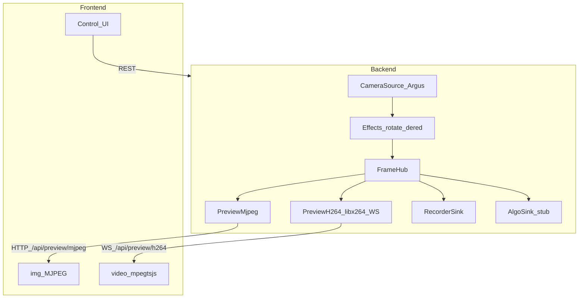

# v2l4_learn 架构设计

> 版本：v1  
> 日期：2026-11-09  
> 状态：已确认，实施中  

## 1. 目标

把早期单文件实现重构为：

- 前后端分离
- 以「视频流」为唯一源
- 预览、录制解耦
- 预留算法接入点
- 预览编码可切换：硬件 JPEG / 软件 H.264，并按实测选择默认

## 2. 约束与现状

| 项 | 结论 |
|----|------|
| 摄像头 | Jetson Orin Nano + IMX219 CSI，`nvarguscamerasrc` |
| 硬件 H.264 | 当前不可用（无 nvv4l2h264enc / 无可用 v4l2m2m 编码设备） |
| 硬件 JPEG | 可用：`nvjpegenc`（预览 MJPEG 优先尝试，失败则回退软件 JPEG） |
| 软件 H.264 | 可用：`libx264` |
| 访问方式 | 局域网 + Tailscale，服务监听 `0.0.0.0:8080` |

## 3. 逻辑架构



原则：

1. 只有 `CameraSource` 打开摄像头
2. 旋转、去红边在进入 Hub 前统一处理
3. 预览 / 录制 / 算法都是 Hub 订阅者
4. 前端不直接碰设备，只调 API / 拉流
5. OSD 时间由前端固定叠加；截图/录像在最终画面上烧录

## 4. 目录结构

```text
v2l4_learn/
  README.md
  doc/架构设计.md
  start.sh                    # python3 -m backend.app.main
  requirements.txt
  backend/app/
    main.py
    config.py
    api/ ...
    stream/ ...
    services/ ...
  frontend/
    index.html
    playback.html
    assets/...
  recordings/
  snapshots/
  settings.json
```

## 5. 预览模式

| 模式 ID | 名称 | 实现 | 前端 |
|---------|------|------|------|
| `mjpeg_hw` | 硬件 JPEG / MJPEG | 优先 nvjpeg，失败回退 OpenCV JPEG；HTTP MJPEG | `` |
| `h264_soft` | 软件 H.264 | libx264 → MPEG-TS → WebSocket | mpegts.js + `<video>` |

- `settings.json` 主要字段：
  - `preview_mode` / `preview_fps`（5~30）
  - `auto_record` / `retention_days`
  - `rotate` / `scale` / `de_red` / `osd`
- 页面下拉可切换，支持 10 秒 CPU 实测后设为默认
- 初始默认：`mjpeg_hw`，15fps，自动录制关闭，滚存 7 天

## 6. API

| 接口 | 说明 |
|------|------|
| `GET /api/health` | 健康检查 |
| `GET/POST /api/settings` | 设置（含帧率/自动录制/滚存；返回 storage 估算） |
| `GET /api/preview/mjpeg` | MJPEG 预览流 |
| `WS /api/preview/h264` | H.264/TS 预览流 |
| `POST /api/snapshot` | 截图 |
| `POST /api/record/start\|stop` | 录制 |
| `GET /api/record/status` | 录制状态 |
| `GET /api/calendar?year=&month=` | 月历：每日绿点/灰点与计数 |
| `GET /api/calendar/day?date=YYYY-MM-DD` | 某日截图/录像列表 |
| `GET /api/storage` | 已用空间与滚存预计占用 |
| `POST /api/storage/cleanup` | 立即按滚存天数清理 |
| `GET /api/playback/list` | 回放列表 |
| `POST /api/playback/open/<id>` | 打开回放 |
| `POST /api/metrics/preview-bench` | 预览模式 CPU 实测 |

页面：`/` 预览（左侧常驻媒体日历），`/playback` 回放；`/calendar` 跳回首页。

## 7. 媒体与滚存

- 文件名：`snapshot_YYYYMMDD_HHMMSS.jpg` / `record_YYYYMMDD_HHMMSS.mp4`
- 录制中：`record_*.part.mp4`（分片，可预览）→ 停止后封装为标准 mp4
- 自动录制按小时切片，便于按天浏览
- `services/media_index.py` 负责日历索引、占用估算、过期清理
- 启动时清理一次；后台约每 10 分钟再清理

## 8. 成功标准

- 页面可切换两种预览，原有功能不回归  
- 实测能对比 CPU，可保存默认模式  
- 帧率、自动录制、滚存可配置并持久化  
- 日历绿点/灰点正确，点击可查看当天媒体  
- 新增算法只需加 Hub 订阅者，不必再开摄像头  
