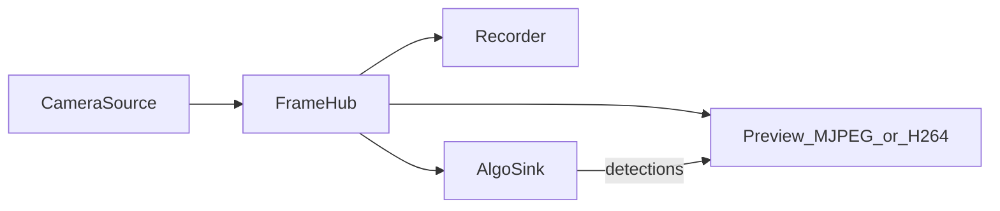

# 算法与模型：原理与部署

> 配合 [架构设计.md](架构设计.md) 阅读。  
> 目标：说明「为什么算法不另开摄像头」，以及物体识别模型怎么下载、放置、切换。

## 1. 一句话原理

摄像头只由 `CameraSource` 打开一次 → 帧进入 `FrameHub` → **AlgoSink** 订阅同一路帧做检测 → 检测框交给预览 Sink 画上去。

所以：

- 开人脸 / 物体识别 **不会再占一路 CSI**
- 关掉算法只是 AlgoSink 不再推理，录像用的 ffmpeg 仍可能在跑（那是录制，不是识别）



## 2. 两种算法模式

网页「算法验证」对应 `settings.json` 的 `algo_mode`：

| 模式 | 做什么 | 模型从哪来 |
|------|--------|------------|
| `off` | 不推理 | — |
| `face` | 人脸框 + Face-N 编号 | 系统自带 OpenCV Haar（`/usr/share/opencv4/haarcascades/...`） |
| `object` | 物体框 + 类别名 + 置信度 | `models/` 下的权重文件（见下节） |

实现文件：`backend/app/stream/sinks/algorithm.py`。

### 2.1 人脸（Haar）

- 经典级联分类器，CPU 很快，适合验证「Hub → Algo → 画框」通路
- 隔帧推理；简单 IOU 跟踪给人脸稳定编号
- **局限**：侧脸、远距离、暗光容易漏检；镜头前没人时检出为 0 是正常的

### 2.2 物体（COCO 检测器）

在 COCO 80 类（人、杯、瓶、沙发、电视……）上找框。流程：

1. 从 Hub 取 BGR 帧  
2. 模型推理 → 若干 `(框, 类别, 分数)`  
3. 按置信度门槛过滤（默认约 **0.25**）  
4. 同类别重叠框做简易 NMS，最多保留约 12 个  
5. 预览叠加橙色框，标签形如 `couch 0.77`

网页「识别模型」对应 `algo_model`：`auto` / `yolov8n` / `fasterrcnn` / `ssdlite`。

## 3. 可选物体模型对比

| 配置值 | 文件（放在 `models/`） | 大约体积 | 特点 |
|--------|------------------------|----------|------|
| `yolov8n` | `yolov8n.pt` | ~6MB | **推荐**：准、相对快（Ultralytics） |
| `fasterrcnn` | `fasterrcnn_mobilenet_v3_large_320_fpn.pth` | ~75MB | 比 SSDLite 准，CPU 更慢 |
| `ssdlite` | `ssdlite320_mobilenet_v3_large_coco.pth` | ~14MB | 轻，但容易误检（如沙发认成 TV） |
| `auto` | 不用单独文件 | — | 按顺序试：YOLO → FasterRCNN → SSDLite |

当前默认推理设备：**CPU**（本机 PyTorch 为 CPU 包；Orin Nano 也 **没有** H.264 NVENC，与算法无关）。

## 4. 模型部署步骤（手动下载）

当前仓库已包含常用权重（`yolov8n.pt` / FasterRCNN / SSDLite）。若自行换模型，把文件放到 `models/` 后按下面命名即可。

### 4.1 目录

```text
v2l4_learn/models/
  .gitkeep
  yolov8n.pt                                          # 推荐
  fasterrcnn_mobilenet_v3_large_320_fpn.pth           # 备用
  ssdlite320_mobilenet_v3_large_coco.pth              # 备用
```

### 4.2 下载地址

**YOLOv8n（推荐）**

```bash
cd /home/lht/sync/v2l4_learn/models
curl -L -o yolov8n.pt \
  'https://github.com/ultralytics/assets/releases/download/v8.4.0/yolov8n.pt'
```

若 GitHub 很慢，可浏览器下载后拷进 `models/`，文件名必须是 `yolov8n.pt`。

**FasterRCNN**

```bash
curl -L -o fasterrcnn_mobilenet_v3_large_320_fpn.pth \
  'https://download.pytorch.org/models/fasterrcnn_mobilenet_v3_large_320_fpn-907ea3f9.pth'
```

**SSDLite**

```bash
curl -L -o ssdlite320_mobilenet_v3_large_coco.pth \
  'https://download.pytorch.org/models/ssdlite320_mobilenet_v3_large_coco-a79551df.pth'
```

### 4.3 Python 依赖

```bash
cd /home/lht/sync/v2l4_learn
pip3 install -r requirements.txt
```

**重要（Jetson）**：

- 摄像头依赖 **系统自带 OpenCV（带 GStreamer）**
- 不要 `pip install opencv-python`；若 ultralytics 把它装上了，请卸掉：

```bash
pip3 uninstall -y opencv-python opencv-python-headless
```

否则会出现打不开 CSI / Argus 会话失败。

### 4.4 启用与切换

1. `./start.sh` 启动服务  
2. 网页「算法验证」→ **物体识别**  
3. 「识别模型」选自动 / YOLOv8n / …  
4. 选择会写入 `settings.json` 的 `algo_mode`、`algo_model`，下次启动仍有效  

API（可选）：

```bash
curl -X POST http://127.0.0.1:8080/api/algo/mode  -H 'Content-Type: application/json' -d '{"mode":"object"}'
curl -X POST http://127.0.0.1:8080/api/algo/model -H 'Content-Type: application/json' -d '{"model":"yolov8n"}'
curl http://127.0.0.1:8080/api/algo/status
```

无人在镜头前时，可用脚本做通路验证：

```bash
python3 scripts/verify_algo.py
```

## 5. 加载与切换时程序在干什么

1. 用户改 `algo_model` → `AlgorithmSink.set_object_model()`  
2. 清空当前模型，代次号 +1（避免旧加载线程把新选择盖掉）  
3. 后台线程按偏好加载权重；YOLO 会预热一帧  
4. torchvision 模型会把 `models/*.pth` **拷进** `~/.cache/torch/hub/checkpoints/`，避免重复联网  
5. 之后每隔几帧推理一次；结果给 `annotate()` 画在预览上  

未下载对应文件时：网页下拉会标「未下载」；强制选择会在 `object_load_error` 里报错。

## 6. 和「CPU 很高」的关系（易混）

| 现象 | 常见原因 |
|------|----------|
| 关掉物体识别，ffmpeg 仍占 CPU | **自动录像**还在用软件 `libx264` 写 MP4 |
| 打开物体识别更卡 | 检测在 CPU 上跑，和录像叠在一起 |
| Orin Nano 硬编码 H.264 | **不支持**（无 NVENC / 无 nvv4l2h264enc） |

## 7. 以后若要换模型

1. 把权重放到 `models/`，约定好文件名  
2. 在 `config.py` 的 `ALGO_OBJECT_MODELS` 增加一项  
3. 在 `algorithm.py` 增加对应 `_try_load_xxx`，并挂到加载表  
4. 前端下拉会跟 `available_models()` / `/api/settings` 的 `algo_models` 走  

不必再开摄像头，也不必改 Source。
